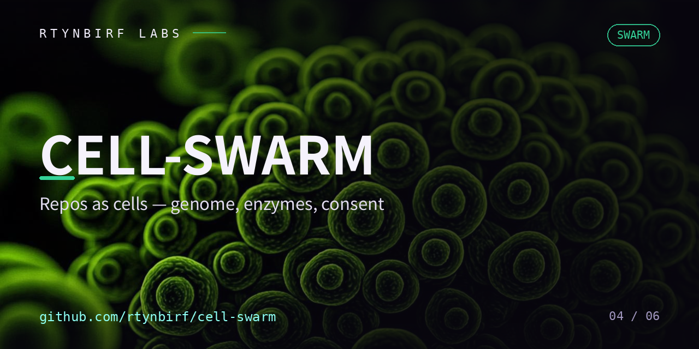

# CELL-SWARM — рой клеток Человека

<p align="center"></p>


[](./LICENSE) [](./swarm.json) [](./bootstrap.sh) [](./README.md)

> Сингулярная эмерджентная архитектура: пять законов, один геном, связь с организмом COMMONS по протоколу согласия (ADR-0017 дома).

## Что это

Рой собственных клеток: репозиториев Человека, связанных **указателями, а не импортами**.
Каждая клетка автономна (clone → make → работает, офлайн), ядро хранит геном `swarm.json`
(пины = SHA коммитов) и фермент `bootstrap.sh` (поднимает рой из одной точки).

Рой — **первый пир дома COMMONS** (github.com/rtynbirf/commons): голос роя —
`peers/peer-manifest.json` по грамматике ADR-0017 дома (PeerManifest: name,
transport, consents, provenance — ровно четыре ключа, fail-closed).
Обмен — только по согласию обеих сторон, до факта, с конвертом крови SPEC-0003
(событие без цены недействительно) и локальным транспортом (stdio/http-localhost).

## Пять законов

1. **Клетка** — автономность: ДНК (`MANIFEST.json`), мембрана (`README` + `AGENTS.md` + `llms.txt`), метаболизм (`Makefile`), тело (файлы).
2. **Окно** — граница репо = граница контекста; митоз по боли контекста: файл → папка → репо.
3. **Указатели** — связь пинами (SHA), не импортами; геном хранит магниты, не контент.
4. **Храповик** — тесты и ADR только добавляются; решение — ADR, отбор — тестами.
5. **Семя** — всё собирается из одной точки: `bootstrap.sh` читает геном и поднимает клетки офлайн.

## Быстрый старт

```bash
make verify            # геном, манифест, голос пира, согласия — fail-closed
make handshake METHOD=genome.read   # вердикт согласия ДО факта обмена
make cross-handshake COMMONS=../commons   # грамматика ДОМА принимает голос роя
make blood-demo        # конверт крови SPEC-0003 с хэш-цепочкой в tmp
make pins              # обновить пины живым ls-remote (с датой)
make bootstrap         # поднять клетки по пинам
```

## Словарь

- **Геном** — `swarm.json`: клетки, пины, роли, мост в дом.
- **Голос роя** — `peers/peer-manifest.json`: объявление второй стороны для дома.
- **Согласия роя** — `consent/grants.json`: на какие методы рой согласен (тоже белый список, «согласие на всё подряд» — не согласие).
- **Кровь роя** — `blood/journal.jsonl` (создаётся emit.py): конверты SPEC-0003, append-only, хэш-цепочка.
- **Прививка** — `sandbox/` (ADR-0007): зеркало песочницы агента. Память агента
  стирается между сеансами — нуль (`sandbox/MEMORY.md`) и точка прерывания
  (`sandbox/STATE.json`) живут в клетке и переживают смерть сессии.

## Лицензия

Apache-2.0 — тот же иммунитет, что у дома (ADR-0003 дома, ADR-0005 роя).
Донорство — только по рукопожатию и тому, кто дарит (ADR-0011 дома).
